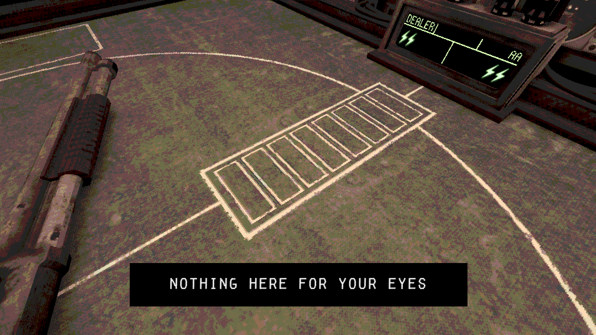
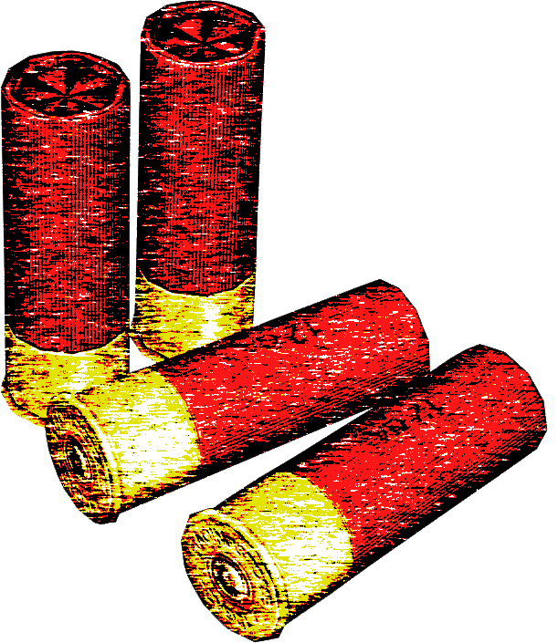
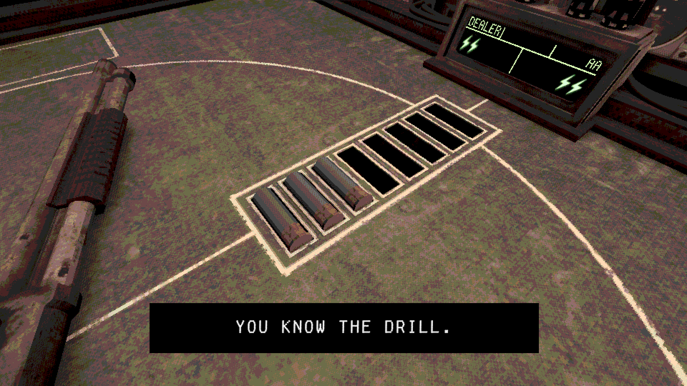
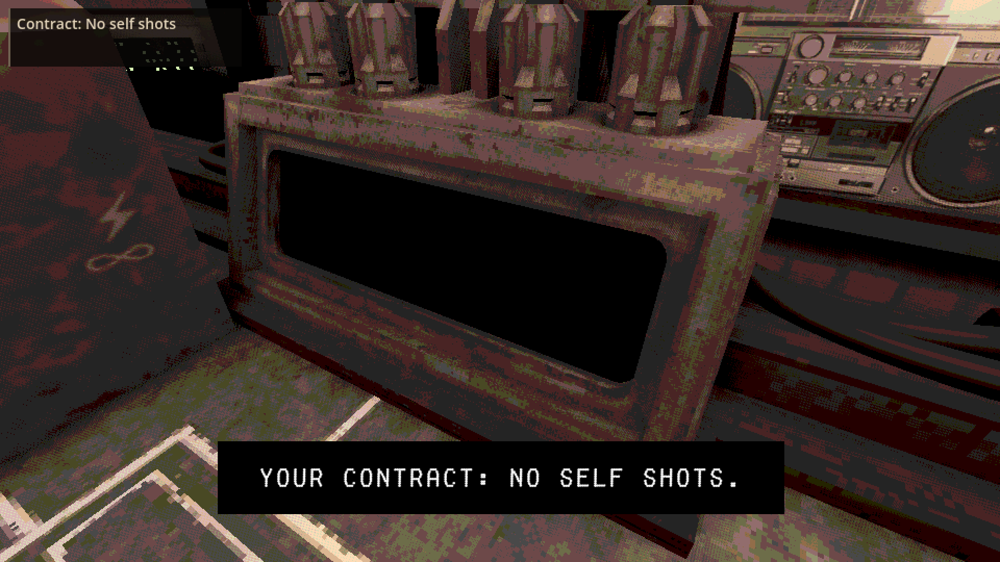
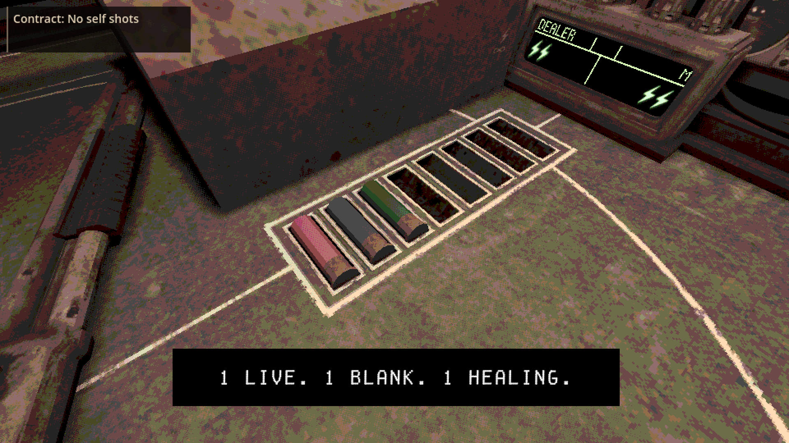

<br />
<p align="center">
   <a href="https://github.com/StarPandaBeg/ChallengePack">
    
   </a>

   <h3 align="center">Challenge Pack - Mod for Buckshot Roulette</h3>

   <p align="center">
    Now I keep even more secrets. <b>Shall we play?</b>
   </p>
</p>

---

> **ChallengePack 2.2.0** for **Buckshot Roulette 2.2.0.6 (Steam, Windows)**. Standard game, Double or Nothing and experimental multiplayer for **2–4 players**. Modified single-player scores are not uploaded to leaderboards.

<div align="center">
  
</div>
<br/>

<p align="center">
Play a real game with the <b>devil</b>! No mercy, now the game becomes really hard! Test your luck dancing on the edge of life and death!
</p>

## Features

Combine nine independent settings in the standard game and Double or Nothing. New rules are off by default.

#### Shell Visibility:

 _Default_ - Show shells as in the original game.

 _Quantity_ - See how many shells there are, but not their types.

 _Hidden_ - Keep both shell count and types a mystery.

#### Items Visibility:

 _Default_ - Keep the dealer’s items visible.

 _Hidden_ - Retractable covers hide the dealer’s items. Peek behind them when stealing.

#### Shuffle Bullets:

 _Yes_ - Use the original game’s shuffling rules.

 _No_ - Load shells in the same order as they appear on the table.

#### First turn:

 _Always First_ - The player starts every charge.

 _Round Robin_ - Take turns starting after each reload, beginning with the player.

 _Random_ - Choose who starts randomly after each reload.

#### Unknown Health:

 _Default / Hidden_ - Hide both health displays and keep count yourself!

#### Mirrored Items:

 _No / Yes_ - Give the dealer a copy of your inventory after each item distribution.

#### Limited Pocket:

 _Unlimited / 1 Item / 2 Items_ - Use at most one or two items per turn.

#### Round Contract:

 _Off / On_ - Choose from twelve contracts and set how often they appear. Restrict items, double damage and healing, or reverse your shot targets. Breaking a restriction ends your run!

#### Heal Bullets:

 _No / Yes_ - Green shells heal their target; shooting yourself keeps your turn. Invert one to create a black instant-kill shell.

Your choices are saved between launches. The compact two-column menu includes tooltips and supports mouse, keyboard and controller. English, Russian and Polish are included, with a What's New screen to introduce the challenges.

## Multiplayer

Everyone needs the **same ChallengePack build**. Create a lobby, open **ChallengePack** and choose the rules. Back in the lobby, every player presses **Ready** beside ChallengePack; the host then starts the match. Only the host can edit settings; changes reset readiness. Solo and multiplayer preferences are saved separately.

All nine modes are available, with a few multiplayer twists:

- Contracts are personal and visible to everyone. Breaking one eliminates its owner until the next round; the others keep playing.
- Jammer restrictions replace handcuff restrictions. Double shots affect the contract owner's shots; Leaky Shotgun redirects a self-shot at a random living rival.
- Mirrored items give all living players matching fresh inventories, respecting the table's item limits.
- Choose a fixed starting player, rotate the first turn, leave it random or keep the original rules. Rival items are invisible without covers; when stealing, choose whose inventory to reveal.

Press **F8** to view rules during play. Ordinary lobbies are hidden while the mod is installed. If the host leaves, the match ends; returning to the lobby lets you start again.

Network behavior has automated checks, but full matches across separate Steam accounts still need manual testing. See [VALIDATION.md](VALIDATION.md#multiplayer-acceptance).

## Installation

1. Download the **2.2.0** archive from [releases](https://github.com/StarPandaBeg/ChallengePack/releases), or [build it from source](#building-from-source).
2. Open the folder containing `Buckshot Roulette.exe` through Steam: **Manage → Browse local files**, then open `Buckshot Roulette_windows`.
3. Extract the entire `ChallengePack` folder next to the executable:

   ```text
   Buckshot Roulette_windows/
     Buckshot Roulette.exe
     ChallengePack/
       install.bat
       uninstall.bat
       src/
   ```

4. Run `ChallengePack\install.bat`.
5. Launch the game through Steam, choose single-player Start to configure a solo challenge, or enter multiplayer to create a modded lobby.

No separate mod loader is required. Keep the entire mod folder together. If upgrading from an old loader-based version, use a clean game installation first.

Only **2.2.0.6** is supported. The mod checks compatibility at startup; compatibility with other mods is not guaranteed.

### Uninstallation

Run `ChallengePack\uninstall.bat`, then delete the mod folder. Other mods and configuration entries remain installed. Uninstall ChallengePack to join ordinary, unmodded lobbies.

### Troubleshooting

Include your game version, selected settings and any error message in [bug reports](https://github.com/StarPandaBeg/ChallengePack/issues). For logs and test coverage, see [VALIDATION.md](VALIDATION.md).

## Building from source

Run `build.bat` with Python 3, Windows PowerShell and Godot **4.1.1** installed. The release archive appears in `dist/`. See [VALIDATION.md](VALIDATION.md#developer-reference) for workspace setup, translations and testing.

## Screenshots

<div align="center">
  
  
  
  
  
</div>

Menu layout may differ.

<br/>

# License

Distributed under the MIT License.

See [LICENSE](LICENSE) for more information.

The contract bomb icon is [Dynamite by Delapouite](https://game-icons.net/1x1/delapouite/dynamite.html), licensed under [CC BY 3.0](https://creativecommons.org/licenses/by/3.0/). Contract warning sounds come from [Kenney Interface Sounds](https://kenney.nl/assets/interface-sounds), CC0.

# Disclaimer

This is an unofficial fan modification, not affiliated with the game developer, and requires a legitimate copy of Buckshot Roulette. No game code or game assets are distributed.

Some scenarios still require manual verification; see [VALIDATION.md](VALIDATION.md). The mod may contain errors or inaccuracies. Feedback and bug reports are welcome! 💗
