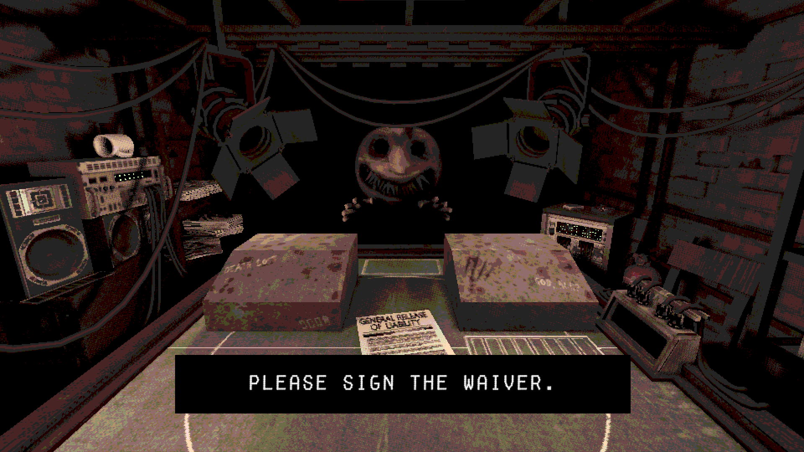

<br />
<p align="center">
   <a href="https://github.com/StarPandaBeg/ChallengePack">
    
   </a>

   <h3 align="center">Challenge Pack - Mod for Buckshot Roulette</h3>

   <p align="center">
    Now I keep even more secrets. <b>Shall we play?</b>
   </p>
</p>

---

> **ChallengePack 2.0.0** for **Buckshot Roulette 2.2.0.6 (Steam, Windows)**, Godot **4.1.1**. Single-player only; multiplayer and leaderboard uploads are disabled while installed.

<div align="center">
  
</div>
<br/>

<p align="center">
Play a real game with the <b>devil</b>! No mercy, now the game becomes really hard! Test your luck dancing on the edge of life and death!
</p>

## Features

Combine nine independent settings for more challenging gameplay in the standard game and Double or Nothing. All new rules are disabled by default; saved configurations keep their existing choices.

#### Shell Visibility:

 _Default_ - Shells are shown as in the original game.

 _Quantity_ - Only the total number of shells is visible. All displayed shells look blank, and composition and sequence sounds are suppressed. Guess which shells are live!

 _Hidden_ - No initial information about the number or types of shells. The compartment stays closed and the dealer always performs eight loading gestures. Test your luck!

#### Items Visibility:

 _Default_ - Items are visible as in the original game.

 _Hidden_ - The dealer can keep secrets: two covers hide his items. Covers temporarily disappear when choosing an item to steal with adrenaline, then return after selection or timeout.

#### Shuffle Bullets:

 _Yes_ - Shells are shuffled using the original game's rules.

 _No_ - A random arrangement is generated once, then shells are loaded in the same order as they lie on the table.

#### First turn:

 _Always First_ - The player always starts after loading, as in the original game.

 _Round Robin_ - The player starts the first load, then the player and dealer alternate starting after each reload.

 _Random_ - The starting player is chosen independently after each reload.

#### Unknown Health:

 _Default / Hidden_ - Hide both health displays and the dealer's one-health warning. Actual health, damage, healing and the final showdown mechanics remain unchanged: keep count yourself!

#### Mirrored Items:

 _No / Yes_ - After each item distribution, replace the dealer's inventory with a copy of the player's complete placed inventory, including leftovers. Both sides start with the same types and quantities, up to eight items; their choices during play can make the inventories diverge again.

#### Limited Pocket:

 _Unlimited / 1 Item / 2 Items_ - Limit the player's item uses per turn. Adrenaline and its stolen item count as one use, including when theft times out. At the limit, items stay on the table and the player can still shoot. Each new playable turn, including another turn after shooting a blank at yourself, resets the limit. Dealer item use is unchanged. Remaining uses are shown on screen.

#### Round Contract:

 _Off / Random / No Healing Items / No Self Shots / No Handcuffs_ - Before each charge, the dealer announces a restriction for the player. Random chooses one of the three restrictions anew each round. In rounds without items it only selects No Self Shots; fixed healing/handcuff restrictions pause until a round with items. Healing items means both cigarettes and expired medicine; shooting yourself is forbidden even with a blank. Restrictions also apply to stolen items. Attempting a forbidden action stops the run before the item or shot is consumed, pauses gameplay and opens a failure screen naming the broken contract. Return to the main menu with the focused button or Escape/Back. A small indicator at the top left shows only the rule (or its paused status) and remaining pocket uses when items are enabled; the dealer is not bound by it.

#### Heal Bullets:

 _No / Yes_ - Replace one randomly chosen blank shell in each charge with a green healing shell, without changing the charge size or live-shell count. It restores 1 HP to the target, up to the usual health cap; it cannot revive anyone or restore a cut defibrillator. Shooting yourself with it keeps your turn, for both the player and dealer. Shooting the opponent passes the turn. Handsaws do not increase healing; inverters leave healing shells unchanged, and beer ejects them without healing. Magnifying glasses and phones identify them correctly. Quantity/Hidden modes still conceal their initial identity. The No Healing Items contract only forbids healing items; No Self Shots also forbids healing self-shots.

Settings are saved between launches and applied when starting a game. Mouse, keyboard and controller UI navigation are supported; Escape/Back returns to the main menu. Magnifying glasses and burner phones still reveal information according to the game's rules.

## Installation

1. Download the **2.0.0** archive from [releases](https://github.com/StarPandaBeg/ChallengePack/releases), or build it from source using the instructions below.
2. Open the folder containing `Buckshot Roulette.exe` through Steam: **Manage → Browse local files**, then open `Buckshot Roulette_windows`.
3. Extract the entire `ChallengePack` folder next to the executable:

   ```text
   Buckshot Roulette_windows/
     Buckshot Roulette.exe
     ChallengePack/
       install.bat
       uninstall.bat
       src/
         challengepack.gd
         modcfg.ps1
         ...other scripts and assets...
   ```

4. Run `ChallengePack\install.bat`.
5. Launch the game through Steam, select the single-player Start button, configure your challenge, and enjoy!

No separate mod loader is required. The installer adds only the `ChallengePack` autoload entry to `override.cfg`; repeating installation updates that entry without duplicates. Keep all mod files together and rerun the installer after moving the game folder. Other configuration entries are preserved, but compatibility with other mods is not established.

This build supports only **2.2.0.6**. If the installed scripts do not match, challenge Start is disabled with an explanation. Do not edit `compatibility.json` merely to bypass that check.

### Uninstallation

Run `ChallengePack\uninstall.bat`, then delete the mod folder. Other mods and configuration entries remain installed. Uninstall ChallengePack to play online again.

Preferences remain in `%APPDATA%\Godot\app_userdata\Buckshot Roulette\challengepack.cfg`; delete that file to reset them. Multiplayer entry and leaderboard uploads are blocked while the mod is installed; Steam achievements are not intentionally disabled.

### Troubleshooting

Look for `[ChallengePack]` in `%APPDATA%\Godot\app_userdata\Buckshot Roulette\logs\godot.log`. The log reports the mod version, compatibility result and attached managers. Include the game version, selected settings and relevant errors in bug reports.

## Building from source

Use Python 3, Windows PowerShell and Godot **4.1.1**. The development tools expect this workspace layout:

```text
workspace/
  ChallengePack/                  # this repository
  game/                          # extracted game project, with project.godot
  godot/
    Godot_v4.1.1-stable_win64.exe
```

Run `build.bat` from the repository root, or double-click it in Explorer. To skip the final pause:

```powershell
.\build.bat /q
```

The script rebuilds `ChallengePack/src/assets/protectors.res` from the mesh and textures in `assets/protectors/`, then creates `dist/ChallengePack-2.0.0-win64.zip` and its SHA-256 checksum. It stops if either step fails. Only `install.bat` and `uninstall.bat` sit at the top of the installable mod folder; its scripts and resources are kept in `src/`. The archive contains the installable mod and documentation; Python and the Godot editor are not required to play.

### Localization

Mod-specific text follows the language selected in the game. Russian is included; other languages fall back to English. Start, Return, Yes and No reuse the game's translations.

Translation catalogs are UTF-8 JSON files in `ChallengePack/src/locales/`: `en.json` contains the base messages, and `ru.json` contains Russian translations. To add a language, copy the keys into `<language>.json` using its lowercase language code (for example, `de.json`). Keep `%s` placeholders in the same order. Missing or empty entries fall back to English. Regional locales such as `ru_RU` use their language catalog. Restart the game after editing a catalog; switching the game's language updates the menu automatically.

### Validation

Run the installer and engine checks from the repository root:

```powershell
python -m unittest discover -s tests -p test_installer.py -v
$repoPath = (Get-Location).Path
foreach ($scenario in @('probe', 'settings_rules', 'localization', 'smoke', 'gameplay', 'challenges', 'contract_hud', 'heal_bullets', 'failure_screen')) {
    python tools/run_godot.py --path ../game --script "$repoPath/tests/$scenario.gd"
    if ($LASTEXITCODE -ne 0) { throw "Check failed: $scenario" }
}
```

For checks against the installed game's embedded resources, pass `--game-exe "D:/.../Buckshot Roulette.exe"` to the runner and omit `--path ../game`. Checks do not install the mod. Logs are written under `tests/.scratch/`, and runs time out automatically.

Compatibility hashes pin the supported game scripts. Update them with `python tools/update_compatibility.py` only after reviewing changes and adapting the mod. See [VALIDATION.md](VALIDATION.md) for automated coverage and manual acceptance checks.

## Screenshots

<div align="center">
  
  
  
</div>

Menu layout may differ.

<br/>

# License

Distributed under the MIT License.

See [LICENSE](LICENSE) for more information.

# Disclaimer

This is an unofficial fan modification, not affiliated with the game developer, and requires a legitimate copy of Buckshot Roulette. No game code or game assets are distributed.

Complete games, visual/audio behavior, physical controller input and real Steam invitations still require manual acceptance; see [VALIDATION.md](VALIDATION.md). The mod may contain errors or inaccuracies. Feedback and bug reports are welcome! 💗
